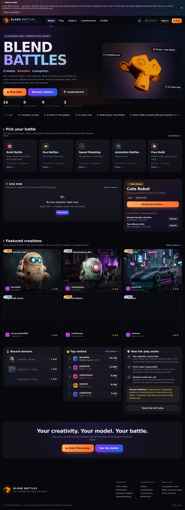

# Blend Battles — Create. Render. Compete.

A competitive arena for Blender artists: get a random theme, model it in Blender before the
clock runs out, submit **a final render plus Blender viewport proof**, then vote on everyone
else's entries and climb from Beginner to Blender Legend.



> **Demo project.** Everything you see is a real working server — auth, uploads, matches,
> votes, moderation and persistence — but the database is a local JSON file and the
> opponents in Quick Play are clearly-labelled simulated bots. Not affiliated with the
> Blender Foundation.

## Quick start

Requirements: **Node.js 18+**. There are **no npm dependencies** — the server is built on the
Node standard library only.

```bash
git clone <this-repo-url>
cd BlendBattle/blend-battles
npm start
# → http://localhost:4173
```

`PORT=8080 npm start` to use another port.

### Demo accounts

| Username | Password | Role |
| --- | --- | --- |
| `NovaKite` | `blendbattles` | Top-ranked artist / moderator |
| `modvex` | `blendbattles` | Moderator (review queue) |

Or click **Continue as guest** — guest sessions are real server sessions, but progress is
not recoverable.

## What actually works

- **Accounts** — register, sign in, guest sessions, scrypt-hashed passwords, httpOnly sessions.
- **Lobbies** — public/private rooms, room codes, readiness, practice bots, host controls,
  5-second reveal countdown, live updates over Server-Sent Events with polling fallback.
- **Matches** — server-owned state machine: `building → submission → voting → results`.
  Refreshing the page never buys extra time.
- **Two-file submissions** — a final render (PNG/JPG/MP4/WebM) and a Blender viewport proof,
  validated server-side with magic-byte sniffing and size limits. Animation mode requires video.
- **Voting** — 1–5 stars per entry, no self-voting, no duplicates, server-side validation,
  automatic early close when every human has voted.
- **Results** — podium, averages, tie-breaking, XP/levels/ranks/badges, gallery + profile history.
- **Moderation** — reports, evidence requests, disqualification/restore, vote invalidation,
  audit log. Only the two demo accounts above have the mod flag.
- **Extras** — daily/weekly challenges, tournament registration, 3D GLB preview (three.js),
  gallery filters, leaderboards, profile editing.

## How a match runs

1. **Lobby** — everyone readies up; the host can add practice bots or set a custom theme.
2. **Build** — the theme is revealed and the server starts the clock (2–20 minutes by mode).
3. **Submission** — upload the final render **and** the viewport proof, then finalize.
   Files can be replaced until the deadline; after that they are locked.
4. **Voting** — every entry is scored 1–5 stars by the other contestants. Proof is one click away.
5. **Results** — podium, XP and rank changes; the lobby reopens for another round.

## Data & persistence

Everything lives in `blend-battles/data/`:

- `data/db.json` — users, sessions, lobbies, matches, submissions, votes, reports, audit log.
  The shipped file is seeded with demo players, past matches and a gallery.
- `data/uploads/` — uploaded files plus generated demo proof images.

To reset to the shipped demo data, restore `data/db.json` (and remove runtime uploads).
Deleting `data/db.json` makes the server reseed a fresh demo database on next boot.

> Note: `data/db.json` is written on every state change. It is fine for a demo or a
> single-instance hobby deployment, but not for multi-instance production hosting.

## Configuration

| Env var | Default | Purpose |
| --- | --- | --- |
| `PORT` | `4173` | HTTP port (binds `0.0.0.0`). |
| `BB_SPEED` | `1` | Compresses demo timers for testing, e.g. `BB_SPEED=0.05` makes a 5-minute build last ~15s. |

## Deploying

**GitHub Pages cannot host this** — it only serves static files, and Blend Battles needs the
Node server for auth, uploads, match timers and voting. Use any Node host instead:

```bash
docker build -t blend-battles blend-battles
docker run -p 4173:4173 -v "$PWD/blend-battles/data:/app/data" blend-battles
```

Or on Render / Railway / Fly.io set the root directory to `blend-battles`, the start command
to `npm start`, and mount a persistent volume at `/app/data` so the JSON database survives
redeploys.

## Project layout

```
blend-battles/
├── server.js              # zero-dependency HTTP server + REST API + SSE
├── lib/
│   ├── auth.js            # sessions, password hashing, public user shape
│   ├── db.js              # JSON persistence + demo seeding
│   ├── render.js          # generated demo proof/render SVGs
│   ├── themes.js          # theme pool + game modes
│   └── util.js            # ranks, levels, ids, PRNG
├── public/                # SPA: index.html, CSS, ES-module views, three.js vendor files
├── data/                  # db.json + uploaded files (runtime state)
└── package.json
```

## Honest limitations

Viewport proof is **supporting evidence, not proof of authorship** — screenshots can be faked.
The project says so in the UI, and moderation plus player reports are what actually hold the
line. There is no AI-detector scoring, no cloud backend, and no email verification.
